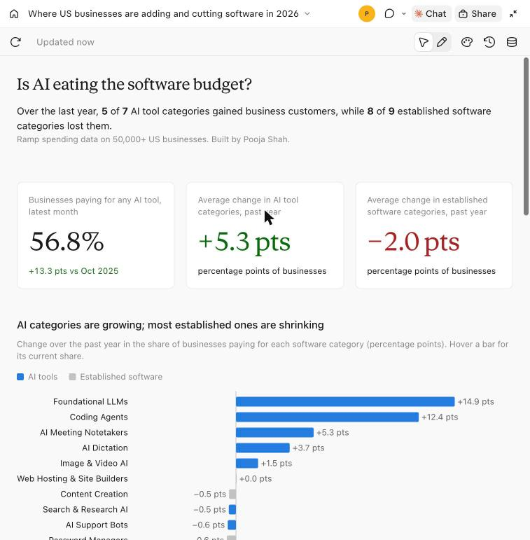
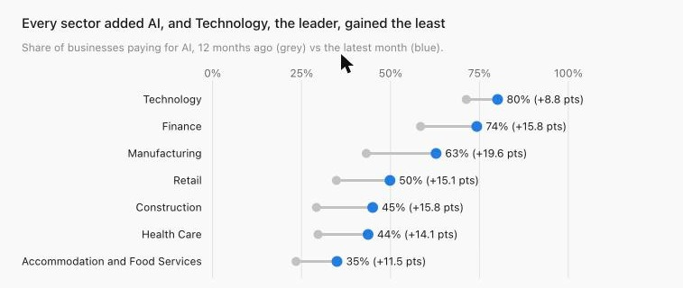

# Is AI Eating the Software Budget?

An interactive dashboard on live spending data from **50,000+ US businesses**, comparing how AI tools and established software gained or lost business customers over the past year.

🚀 **[Live demo: open the interactive dashboard](https://drpoojashah.github.io/ramp-software-spending-dashboard/)** (no login needed)

🔗 **Project page:** [Handshake AI Showcase](https://app.joinhandshake.com/ai-showcase/projects/3819656)

## Key findings (snapshot, November 2026)

- **5 of 7 AI tool categories** gained business customers over the past year, while **8 of 9 established software categories** lost them.
- AI tool categories grew **+5.3 percentage points** on average; established software fell **−2.0**.
- Biggest gainers: **Foundational LLMs +14.9 pts** (now 62.4% of businesses) and **Coding Agents +12.4 pts**.
- Biggest decliners: **Email Marketing −3.6**, **Project Management −3.6**, **Communication −3.4**, **CRM −2.0**.
- **56.8%** of businesses now pay for at least one AI tool, up **13.3 pts** in 12 months.
- **Every sector** added AI. Technology, the leader, gained the least (+8.8 pts); Manufacturing gained the most (+19.6 pts).

## What the dashboard contains

| Section | Chart | Question it answers |
|---|---|---|
| Headline + KPI tiles | Text and numbers computed from data | How fast is AI adoption growing, and is software shrinking? |
| Categories | Diverging bar chart (16 categories) | Which categories gained or lost customers in the past year? |
| Sectors | Dumbbell / dot plot (7 sectors) | Which industries are catching up on AI? |
| Company size | Line chart (24 months) | Do small businesses lag behind large ones? |
| Vendors | Bar chart with category dropdown | Who wins inside LLMs, coding agents, project management and communication? |

Every chart has hover tooltips, and every number on the page traces back to its source query.

## How it works

- **Live data:** the page queries the **Ramp Data** connector (Ramp AI Index and Ramp Rate) each time it opens, so the numbers update on their own.
- **Loaders** (JavaScript) flatten the API's nested JSON into tidy rows. For example, one row per month and sector.
- **Calculations** such as the 12-month change, the growing-vs-shrinking counts and sector deltas are declared as traceable calcs, not hidden in chart code.
- **Charts** are hand-built with **D3.js**, sized to the screen width, with labels measured so they never overlap.

`dashboard_index.html` is the full page source. It runs inside the Claude Data dashboard runtime, which provides the live connector and the `dash` API, so it is not a standalone web page.

## Data snapshot

The public site (`index.html`) runs on a saved snapshot of the data, so anyone can open it. The original live version is `dashboard_index.html`. Snapshot files:

| File | Contents |
|---|---|
| `software_categories_snapshot.csv` | 16 categories: group, current adoption %, past-year change (pts) |
| `vendor_leaderboards_snapshot.csv` | Top vendors in 4 categories: share of category buyers, past-year change, share of category spend |

## Limits

- Ramp sees only card and bill-pay spending; free tiers and tools paid another way are not counted.
- "AI tool" adoption (AI Index) and category adoption (Ramp Rate) are measured differently, so the two aren't directly comparable.
- Vendor shares overlap: one business can pay several vendors in the same category.
- Which categories count as "AI tools" is this dashboard's own grouping.

## Skills shown

Dashboard design · data visualization (D3.js) · API data wrangling (JavaScript) · KPI design · data storytelling

---
Built by **Pooja Shah** as part of Handshake AI Skills Studio · [LinkedIn](https://www.linkedin.com/in/drpoojashah)
